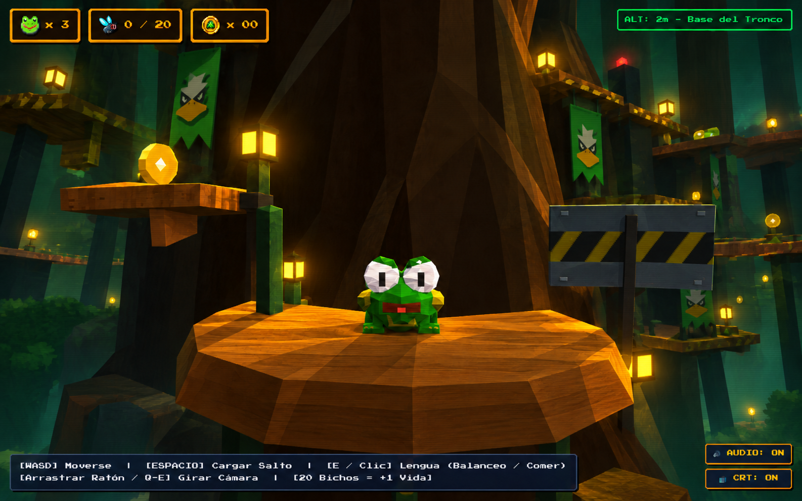

# Froggy Fight

Plataformas 3D en Three.js con Frogbert, Pato Lemus, TALACORP y ascenso por el Árbol Sagrado. La fuente conserva el juego 3D y la lógica de movimiento/salto; esta rama de trabajo añade un primer pase visual y controles responsive.

## Estado

El build de la fuente compila. La ronda final de Playwright comprobó HTTP 200, cero errores de consola/red y ajuste de canvas en escritorio, portrait y landscape. La verificación cubrió interacciones iniciales, no una partida completa: recorrido, cima y jefe siguen pendientes. Las banderas cargan la cara de Pato Lemus, aunque no se lee en el encuadre inicial porque quedan fuera o cortadas. Vite reporta el bundle JavaScript de 641 kB sobre su umbral de 500 kB.

## Dirección visual

La imagen de abajo es un concepto IA v2 preparado para orientar el pulido. No es una captura del juego ni una reconstrucción exacta de la referencia visual original del usuario. La referencia original se describió como Pato Lemus con traje frente a un bosque vertical cálido; no se conserva como archivo en este repositorio.



[Abrir el concepto v2](docs/evidence/art/frogbert-concepto-v2-pato-lemus.png).

## Para continuar

- [Hoja de ruta y objetivo visual/gameplay](docs/roadmap.md)
- [Informe, clips y capturas de evidencia](docs/evidence/REPORT.md)
- [Conceptos, prompts y procedencia del asset](docs/evidence/art/)
- [Handoff técnico](CODEX_HANDOFF.md)

## Ejecutar

```bash
npm ci
npm run dev
```

Abre `http://localhost:5173/`. Para compilar: `npm run build`; para preview compilado: `npm run preview`.
